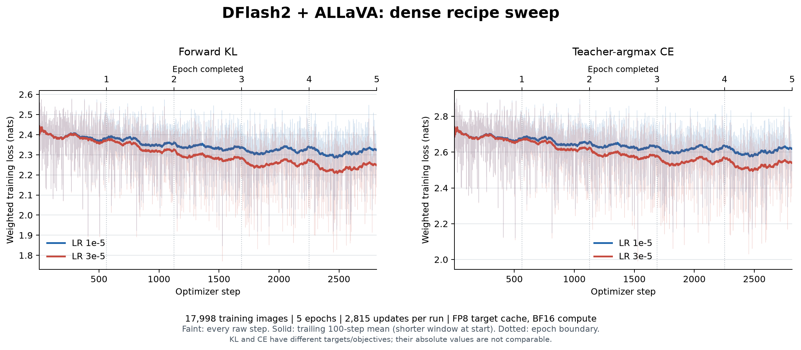
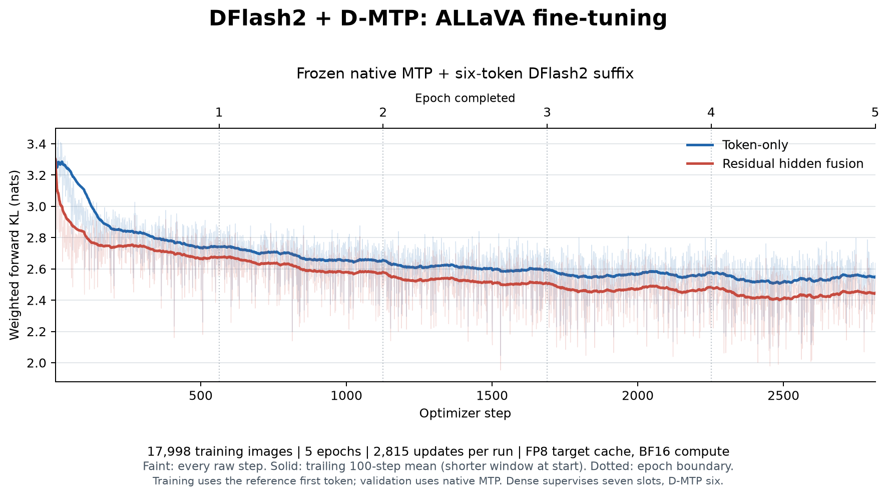

# DFlash2 + ALLaVA 与 DFlash2 + D-MTP

这是两套历史实验的包内训练实现。统一入口为 `speculators train-cached-dflash2`，三种模式是 `dense`、`token`、`fusion`，共用缓存读取、冻结 head 的 loss、验证、续训和导出。原有 `speculators train` 行为保持兼容。

这里的 `dense` 指 DFlash2 草稿模型；Qwen 目标模型提供蒸馏回答和缓存特征，权重保持冻结。本命令不对 Qwen 本体做多模态 SFT。

这条路径用于已有 DFlash2 HF checkpoint 和经过图像身份/时序审计的 target/MTP 缓存。它保留实验的 FP32 卷积累加、frozen selector 等计算约定，因此使用独立的 checkpoint 兼容 backbone；它没有把这些实验改成通用 Trainer 的另一套默认配置，也没有注册成普通 `mtp` 预训练。**D-MTP 里的原生 MTP 冻结，训练的是 DFlash2 后六位及可选融合层。**

- [训练与数据契约](TRAINING.md)
- [vLLM 推理、接受指标及输出一致性](VLLM_INFERENCE.md)
- [同事 AI 接手入口](AI_HANDOFF.md)
- [内网业务数据格式、缓存检查与训练命令](BUSINESS_DATA.md)
- [验证记录](VALIDATION.md)
- [六个配方](../../examples/cached_dflash2)

## 对应结构

| 模式   | 首位来源       | DFlash2 输入                    | 训练预测位置 | 可训练部分               |
| ------ | -------------- | ------------------------------- | ------------ | ------------------------ |
| dense  | DFlash2        | pending token A + 7 masks       | T1…T7        | backbone                 |
| token  | 冻结的原生 MTP | T1 + 6 masks                    | T2…T7        | backbone                 |
| fusion | 冻结的原生 MTP | 融合后的 T1 embedding + 6 masks | T2…T7        | backbone + anchor fusion |

Fusion 默认为 `embedding(T1) + W[RMS(embedding(T1)); RMS(native_MTP_hidden)]`，`W` 零初始化，因此初始后六位与 token-only 一致。训练时 T1 取蒸馏 transcript 的 gold token；缓存验证和在线推理取原生 MTP 的 T1。后段训练不会改变固定前缀上原生 MTP 的首位能力。

## 历史 loss 曲线

以下来自 2026-11-02/03 的真实旧运行，每组 5 epoch、2815 次更新；不是本次代码重构后重新训练的曲线。Dense 的 KL 与 CE 分图展示，不能按 loss 数值跨目标比较；D-MTP 只监督后六位，其 loss 与 dense 七位均值也不是完全相同的量。

原始六份 `train.jsonl`、完整历史代码及来源审计见[固定归档 commit](https://github.com/Bensong0506/speculators-wenxuan/tree/bb5a1b1a4dbf97d4cd968f011a97fb458f229dc7/research/allava20k_finetune_20261104)。本目录同时提供 PDF、逐 epoch 表和曲线审计。新运行可用 `scripts/plot_cached_dflash2.py` 从实际日志重新绘制。

历史独立 1000 test 图、FP8 目标、K=7、C64 上限、三次 GPU 轮换的均值：dense AR 25.2811764% / AL 2.76968235；token AR 24.6634398% / AL 2.72644078；fusion AR 25.5566639% / AL 2.78896648。Fusion 相对 dense 为 +0.275488 个百分点 / +0.019284 AL。**D-MTP 有未解决的跨卡输出差异，这些数据不能作为已验证的无损收益。** 不同验证集、并发、精度或缓存指标不能直接相减。
