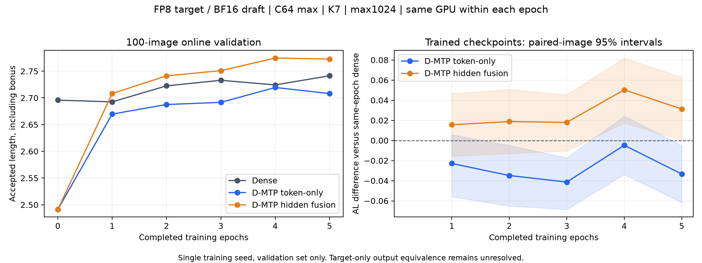
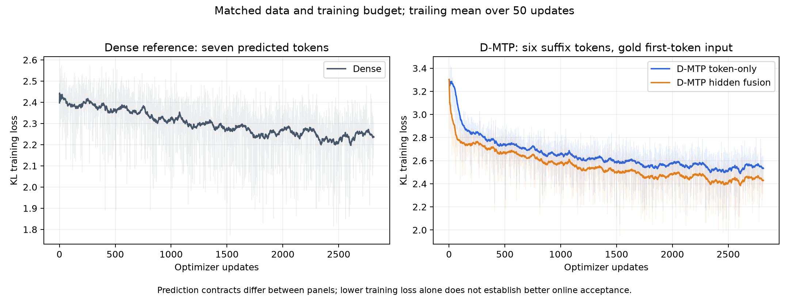

# ALLaVA D-MTP 实跑归档：2026-11-10

本次以同一初始化、数据顺序和五轮训练预算，对比 Dense、D-MTP token-only 与 D-MTP hidden fusion。两组 D-MTP 已各完成 2815 次更新；Dense 复用此前同预算训练的权重，并在本次环境重新进行在线评测。三组 epoch 0–5 共 18 次、每次同 100 张验证图的在线评测均完成。

**Fusion 的接受指标有小幅改善，token-only 没有改善；输出等价仍未通过，不能称为已验证的无损加速。** 本归档是已完成实验的记录，不是启动指令。它不包含图片、prompt、回答、模型权重或登录凭据。

## 结果

下表全部是本次 **100 图在线** 结果。目标 Qwen3.8-Flash-Next 使用 FP8 权重，草稿导出为 BF16；C64 为并发上限，KV32 GiB、B2048、graph、K7、max1024。AR 为已接受草稿 token / 提议 token，AL 包含一个 bonus token。

| Epoch |   Dense AR | Dense AL |   Token AR | Token AL |  Fusion AR | Fusion AL |
| ----- | ---------: | -------: | ---------: | -------: | ---------: | --------: |
| 0     | 24.225787% | 2.695805 | 21.304324% | 2.491303 | 21.304324% |  2.491303 |
| 1     | 24.179277% | 2.692549 | 23.852520% | 2.669676 | 24.402126% |  2.708149 |
| 2     | 24.606945% | 2.722486 | 24.109486% | 2.687664 | 24.874990% |  2.741249 |
| 3     | 24.756043% | 2.732923 | 24.165733% | 2.691601 | 25.012889% |  2.750902 |
| 4     | 24.632387% | 2.724267 | 24.564332% | 2.719503 | 25.351436% |  2.774601 |
| 5     | 24.877125% | 2.741399 | 24.401003% | 2.708070 | 25.323670% |  2.772657 |

同第五轮预算下，fusion 相对 dense 的 AR **+0.446545 个百分点**、AL **+0.031258（约 +1.14%）**。图像配对 bootstrap 的 AL 差值 95% 区间为 `[0.0002103, 0.0628615]`，仅有边缘的小幅优势。Token-only 的 AR **−0.476122 个百分点**、AL **−0.033329**，AL 区间 `[-0.0617189, -0.0048881]`。

Fusion 的在线最高点为 epoch 4，与 epoch 5 很接近；这是在验证集上探索性挑选的 checkpoint，未运行新增独立 test、第二个训练 seed 或 BF16 目标对照。区间来自 2000 次图像配对重采样，未对 checkpoint 选择或多重比较校正。不按吞吐选择配方；JSON 保留的耗时不能覆盖正确性失败。





Dense 监督七个候选位置，D-MTP 监督后六位且训练时输入 gold 首位，因此 loss 分面展示，不能直接用两面板的绝对高低判定优劣。

## 训练设置与代码

- 代码基线：`847b8c89f5786793efe726fe1e79ef1aeb3d2f02`。本提交收录实跑时尚未提交的评测显存门限参数补丁；见 [原始补丁](provenance/evaluation-startup-budget.patch)。训练数学未更改。
- 起点是此前 ALLaVA 两轮训练选出的 step 1100，三组使用同一份起始权重；本次 epoch 0 不是从未增训的 DFlash2。D-MTP 也不是接在本次 dense epoch 5 后再多训五轮。
- 按图像分组的 20k 缓存原为 18000 train / 1000 val / 1000 test；2 条训练回答过短被排除，有效 train 为 **17998 图**。每组五轮 **89990 图次 / 2815 更新**。本次线上取同一批 100 张 val，未使用 test。
- KL `3e-5`，seed 280；batch 上限 32，padded context budget 48000；每图 64 个训练 anchors、8 个缓存验证 anchors；20% warmup 后线性衰减。
- FP32 master weights / Adam，BF16 autocast；冻结 embedding/head、selector、原生 MTP。全词表同前缀 KL，不是只在 top-16 上计算 KL；top-16 供 selector 使用。
- Token-only 使用原生 MTP 的 T1 作为后段输入；fusion 另加入零初始化残差 hidden 融合。训练 T1 使用 gold transcript，缓存验证/在线使用 native candidate。后段增训不会提高冻结 MTP 在同一固定前缀上的 T1。
- 实跑为两张 GB300，每组单卡单进程，训练 allocator 上限 96 GiB。所有 12 份 D-MTP epoch 0–5 导出的 safetensors dtype 均经检查为 BF16。

核心实现位于 [cached_dflash2](../../../../src/speculators/train/cached_dflash2)，尤其是 [dmtp.py](../../../../src/speculators/train/cached_dflash2/dmtp.py)、[trainer.py](../../../../src/speculators/train/cached_dflash2/trainer.py) 和 [loss.py](../../../../src/speculators/train/cached_dflash2/loss.py)。使用缓存格式前完整阅读 [训练契约](../../TRAINING.md) 和 [业务数据交接](../../BUSINESS_DATA.md)。原生 MTP sidecar 必须是真实 causal hidden/token，不能用 target 最后一层 hidden 代替。

以下是复现配方的命令模板，操作者须先提供兼容数据、权重和本轮已分配的 GPU；使用全新的输出目录，不对已完成实验再次启动。

```bash
export DFLASH2_INITIAL=/personal/models/common-initial
export DFLASH2_SHARED=/personal/cache/shared.pt
export ALLAVA_CACHE_MANIFEST=/personal/cache/native-mtp-manifest.json
export EXPERIMENT_ROOT=/personal/new-runs/dmtp-allava
ARCHIVE=docs/cached_dflash2/results/allava_dmtp_20261110

# 两组分别先检查全部缓存和独立 3 步 pilot，再进入正式训练。
for arm in token fusion; do
  python -m speculators.train.cached_dflash2 \
    --config "$ARCHIVE/configs/$arm.yaml" --check-data
  CUDA_VISIBLE_DEVICES=0 python -m speculators.train.cached_dflash2 \
    --config "$ARCHIVE/configs/$arm.yaml" \
    --output "$EXPERIMENT_ROOT/pilot-$arm" --pilot-steps 3 --pilot-val-images 8
done

# 在本轮分配的两张卡上各运行一组；此处顺序执行也可复现配方。
CUDA_VISIBLE_DEVICES=0 python -m speculators.train.cached_dflash2 \
  --config "$ARCHIVE/configs/token.yaml"
CUDA_VISIBLE_DEVICES=1 python -m speculators.train.cached_dflash2 \
  --config "$ARCHIVE/configs/fusion.yaml"
```

`training/*/run.yaml` 和命令记录中的 `${...}` 是脱敏占位符，留作证据。启动使用 `configs/*.yaml` 及其上面的环境变量。

## 在线设置与正确性

D-MTP 需要 [固定 vLLM overlay](../../../../integrations/vllm_dmtp) 和基线 `bbf5893213eff1e1dc7bbe76ce410b31eaca1507`；普通上游 vLLM 的 `method=mtp` 不会自动组合 DFlash2。安装、版本/摘要核对和小图比较见 [推理契约](../../VLLM_INFERENCE.md)。本次使用 V2 runner、Triton MoE、无 prefix caching，temperature 0、关闭 thinking，max model length 8192。图像 resize 和全部 engine kwargs 保存在每次 run 中。

实跑环境：ARM64 GB300，PyTorch `2.14.0a0+b2c75dd062.nv26.09`、CUDA 13.4、vLLM 0.31.0；完整版本行保存在 `train_command.txt` / `vllm_command.txt`。版本字符串相同不代表二进制扩展兼容。

完成小图与容量检查后，单个 epoch 的评测模板如下。Dense/token/fusion 在同一 epoch 上使用同一张 GPU（epoch % 2），不同模式顺序执行；三组使用完全相同的 prompts 和资源设置。Dense 的 `$DENSE_RUN` 指向同起点、同五轮预算训练的独立输出。

```bash
export TARGET=/personal/models/qwen-fp8-target
export RUNTIME_ROOT=/personal/src/pinned-vllm
export VAL_PROMPTS=/personal/data/val100-prompts.jsonl
export DENSE_RUN=/personal/runs/dense-kl-3e-5
export VLLM_USE_V2_MODEL_RUNNER=1
epoch=5
epoch_name=$(printf '%02d' "$epoch")
gpu=$((epoch % 2))
for arm in dense token fusion; do
  run="$EXPERIMENT_ROOT/$arm-kl-3e-5"
  if [ "$arm" = dense ]; then run="$DENSE_RUN"; fi
  CUDA_VISIBLE_DEVICES="$gpu" python scripts/evaluate_cached_dflash2.py \
    --mode "$arm" --target "$TARGET" --target-precision fp8 \
    --draft "$run/epochs/epoch-$epoch_name" \
    --runtime-root "$RUNTIME_ROOT" --prompts "$VAL_PROMPTS" \
    --provenance-dir "$EXPERIMENT_ROOT/online/epoch-$epoch_name-$arm" \
    --limit 100 --max-tokens 1024 --concurrency 64 --kv-cache-gib 32 \
    --gpu-memory-utilization 0.65 --batched-tokens 2048 --graph --progress
done
```

显式 KV 为 32 GiB，`gpu_memory_utilization=0.65` 用于通过启动时的可用显存门限；它没有把 KV 改成显存的 65%。GB300 本次还在 SHA256 校验后对本作业所有的私有 SSD 权重文件调用 `POSIX_FADV_DONTNEED` 回收文件页缓存；[wrapper 快照](provenance/evaluate_owned.py.txt) 记录了这个环境处理，不改变模型数学，不应对共享文件照搬。固定 overlay 的 22 个文件未修改。

正确性证据必须与接受指标一起阅读：

- 初始 C1/eager 的 16 图检查中，dense/token/fusion 各 **16/16** 条输出不同于 target-only；三者均未通过目标输出等价。
- 初始 token 与零残差 fusion：16 图及本次 C64 的 100 图输出均完全相同，确认零融合退化关系覆盖这些样本。
- 已训练 token/fusion 与同 epoch dense：各 **100/100** 条输出不同；生成后的前缀分布也不同，线上首位率不能当作同前缀配对证据。
- Dense epoch 5 的额外跨 GPU 100 图重复：**0/100** 条输出变化，AR/AL 相同。Dense epoch 0/1 与此前运行也完全相同。这不替代 D-MTP 的跨卡重复，不代表历史 D-MTP 跨卡异常已解决。
- 全部 18 个 run 的目标权重指纹一致，checkpoint/epoch/GPU/输入合同审计通过；这只证明本次执行合同，不证明通用输出等价。

## 缓存结果单独看

缓存验证每组每轮 **1000 图 × 8 anchors**。第五轮 Dense / Token / Fusion 的 teacher-selected AL 为 **3.1505 / 3.12325 / 3.170375**；AR 为 **30.721429% / 30.332143% / 31.005357%**。缓存 T1：dense 76.95%，两组冻结 native MTP 都为 75.1625%。这些来自固定缓存前缀，不能与上表的在线指标相减，也不属于另一次在线实测。

## 归档内容与本地复核

- `training/{dense,token,fusion}`：每步数值 loss/梯度/LR 日志、初始与逐轮缓存验证、summary、脱敏配置/命令、代码与输入摘要；数字未重采样。
- `online/epoch-*/`：18 份 summary、engine 设置、权重摘要、运行时记录、源码补丁，以及脱敏逐图计数。样本使用稳定序号，回答 token IDs 替换为规范 JSON 的 SHA256，保留输出相同/不同核对能力。
- `results/`：在线比较和 bootstrap 区间、单独缓存比较、执行合同审计、导出 dtype 审计、dense 重复输出核对。
- `provenance/`：原始工件摘要和脱敏规则；`*.txt` 是原运行脚本快照，包含路径占位符，不能直接执行。权重/图片/原始回答和私有完整记录由原操作者保管。
- `plots/`：PNG 与 PDF；`reproduce_plots.py` 从随附的真实数值日志重画。

在安装了 NumPy / Matplotlib 的 CPU 环境里，不需要模型或 GPU：

```bash
python docs/cached_dflash2/results/allava_dmtp_20261110/verify_results.py
python docs/cached_dflash2/results/allava_dmtp_20261110/reproduce_plots.py
```

复核脚本会从逐图计数重新计算 AR/AL、2000 次配对 bootstrap 和输出差异数量，并检查三组各 2815 条 loss 日志。它不运行生成、不证明缓存时序或输出无损；目标模型/原始数据不随本仓库提供，单独克隆本仓库无法重新运行完整模型评测。
