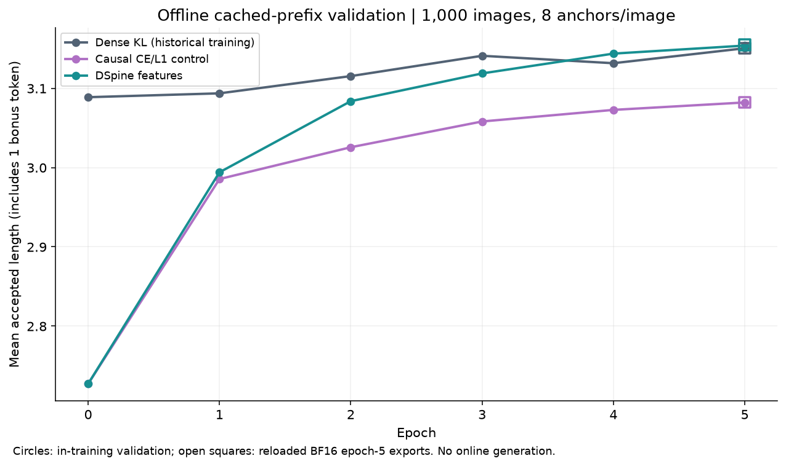
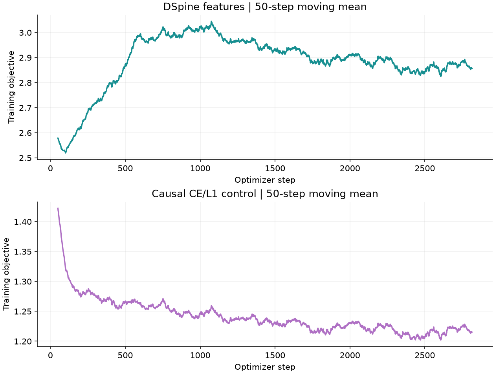

# Qwen3.8-Flash-Next：DSpine 离线结果（2026-11-11）

本轮 DSpine 相较 dense 的离线 AL 差为 +0.004250，95% 配对区间跨零，未显示稳定优势；相较因果对照提高 0.072625，区间为 [0.056250, 0.089250]。

现有 DFlash2 草稿上的五层缓存特性移植。固定第 5 轮、重新加载 BF16 导出权重，在同 1000 张验证图片、每图 8 个固定 anchor 上评估。目标缓存来自 FP8 Qwen3.8-Flash-Next；这是 cached-prefix proxy，未执行在线生成。

| 方案                           | 第 5 轮离线 AR | 第 5 轮离线 AL |
| :----------------------------- | -------------: | -------------: |
| Dense KL (historical training) |     30.721429% |       3.150500 |
| Causal CE/L1 control           |     29.744643% |       3.082125 |
| DSpine features                |     30.782143% |       3.154750 |

AR = 连续接受的草稿 token 数 / (7 × blocks)；AL = 1 + 连续接受 token 数 / blocks，含 1 个 bonus token。teacher 标签来自保存转录的对应前缀，不能当作重新生成分叉前缀后的真实在线验证。

## 配对差值

- `dspine_minus_dense-reference`：AL 差 +0.004250，95% 图片配对 bootstrap 区间 [-0.021000, +0.029875]；AR 差 +0.060714 个百分点。
- `dspine_minus_dspine-causal-control`：AL 差 +0.072625，95% 图片配对 bootstrap 区间 [+0.056250, +0.089250]；AR 差 +1.037500 个百分点。
- `dspine-causal-control_minus_dense-reference`：AL 差 -0.068375，95% 图片配对 bootstrap 区间 [-0.092128, -0.044125]；AR 差 -0.976786 个百分点。

Bootstrap 以图片为单位，每图保留全部 8 个 anchor，10000 次重采样、seed=20261111。区间只反映该验证集的图片抽样，不覆盖训练 seed 波动。只有一个训练 seed，不以验证集上最高轮次替代预先固定的第 5 轮。

## 训练与复现

本轮新训练均为 5 轮、2815 次更新、17998 张有效训练图、seed=280、lr=3e-5、batch上限32、context budget48000、每图64训练anchors、8验证anchors。初始权重已有训练历史，本轮是继续训练。dense KL 训练曲线来自 2026-11-10 已完成的匹配基线；本轮重新评估了它的第 5 轮导出。原始权重、shared head、样本/批计划 SHA 已逐项相等核对，见 `comparison.json`。

DCore 保留五层缓存、原投影/卷积和冻结 selector，加入每层目标层混合、独立目标 K/V、D-PACE。DSpine 保留原卷积，采用因果 query attention、相邻注入/对齐/候选 refinement；其 causal control 同时关闭注入、refinement、alignment。两者均为特性移植，不能标成官方完整复现。不同训练目标的 loss 数值不可横向比较。DSpine 的对齐项权重在 warmup 期间增加，因此前段总 loss 上升需要结合分项与验证指标解释。





圆点为训练过程中的 FP32 master + BF16 autocast 验证；方框为重载 BF16 导出的第 5 轮指标。两者数值可能略有差异，主表取后者。`initial.json`、`validation.json`、`train.jsonl` 保留各轮和每步计数。

比较固定了更新步数；新增模块带来额外参数和计算，参数量见各组 `provenance.json`，不据此推断在线速度。

各方案目录保存脱敏后的训练命令、配置、provenance、patch 和导出 SHA；`exports/` 保存逐图计数及评估命令/patch；`evaluation_source.txt` 是本次原始逐图评估脚本的完整快照，其 SHA 在评估 provenance 中。`${...}` 代表需映射到个人路径的占位符。服务器权重、原始图片和转录未进入仓库。

本分支提供相同计数逻辑的可复用入口：

```bash
python scripts/evaluate_cached_prefix_counts.py --kind dspine \
  --run "$EXPERIMENT_ROOT/dspine" \
  --checkpoint "$EXPERIMENT_ROOT/dspine/epochs/epoch-05" \
  --output /personal/results/epoch05-counts.json

python scripts/compare_cached_prefix_counts.py \
  --input dense docs/cached_dflash2/results/qwen38_dspine_20261111/exports/export-dense-reference-epoch05.json \
  --input dspine docs/cached_dflash2/results/qwen38_dspine_20261111/exports/export-dspine-epoch05.json \
  --reference dense --output /personal/results/comparison.json
```

只有缓存目录搬迁时才使用 `--manifest`；脚本要求验证图片、token边界和缓存摘要与原 manifest 完全一致。训练入口与移植差异见 [特性文档](../../FEATURE_DSPINE.md)。

组件测试、真实 GPU 试跑、完整缓存校验、导出重载及定向类型检查通过。全仓质量命令仍被相同环境下基线已有的 208 条依赖/旧 torch 类型错误阻塞，本分支没有新增；记录见 `validation-checks.json`。本轮未验证在线接受率、吞吐或输出等价。
